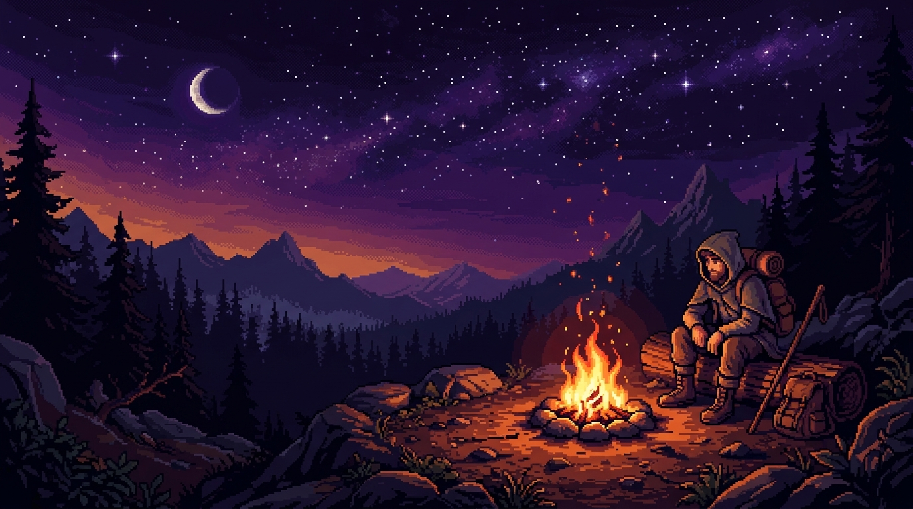

<div align="center">

  <!-- HERO BANNER -->
  

  <br />

  <!-- ANIMATED TYPING HEADER -->
  <a href="https://github.com/pranavk429">
    
  </a>

  <p align="center">
    <b>Serial Idea Shipper</b> &bull; <b>AI Co-Piloted Explorer</b> &bull; <b>Building Across All Genres</b>
  </p>

  <p align="center">
    
    
    
    
  </p>

</div>

---

### ☕ The Vibe Coder Terminal

```text
╭────────────────────────────────────────────────────────────────────────────╮
│  pranavk429@vibe-station:~ (ai-vibe --diagnostics)                         │
├────────────────────────────────────────────────────────────────────────────┤
│  ● IDENTITY        : Pure AI Vibe Coder (I don't write syntax, I vibe)     │
│  ● FLOW STATE      : 45 hours / day co-creating software with AI           │
│  ● GENRES          : Games · Audio Tools · Autonomous Agents · Web · Apps  │
│  ● CO-PILOTS       : Claude · Antigravity · Cursor · OpenCode · Gemini     │
│  ● PHILOSOPHY      : "If an idea pops up, prompt it, iterate, and ship."  │
│  ● SYNTAX FEAR     : Zero. AI handles the boilerplate, I steer the vision. │
╰────────────────────────────────────────────────────────────────────────────╯
```

---

### 🎨 The Multi-Genre Workshop

> *"I don't box myself into one tech stack or one domain. With AI, every industry is an open playground. Here are some of the varied spaces I've vibe-coded into existence:"*

<table>
  <tr>
    <td width="50%" valign="top">
      <h3>🎮 Games & Emergent Worlds</h3>
      <p>Building interactive worlds, hive-mind NPC systems, and emergent game logic powered by persistent memory.</p>
      <ul>
        <li><a href="https://github.com/pranavk429/echo"><b>Echo</b></a> — NPC hive-mind game with hybrid graph-vector memory.</li>
      </ul>
      <p>
        
        
      </p>
    </td>
    <td width="50%" valign="top">
      <h3>🎧 Audio Labs & Creative Web</h3>
      <p>Prototyping audio utilities, sound test labs, and creative browser experiments fueled by rapid AI iteration.</p>
      <ul>
        <li>Interactive sound generation, audio diagnostic platforms & web experiences.</li>
      </ul>
      <p>
        
        
      </p>
    </td>
  </tr>
  <tr>
    <td width="50%" valign="top">
      <h3>🛡️ Policy Gateways & Agent Safety</h3>
      <p>Directing AI to build guardrails for other AI models so tools execute securely without exfiltrating data.</p>
      <ul>
        <li><a href="https://github.com/pranavk429/Ark-Agents"><b>Ark-Agents</b></a> — Fail-closed policy gateway & taint tracking.</li>
      </ul>
      <p>
        
        
      </p>
    </td>
    <td width="50%" valign="top">
      <h3>🔭 SRE Tools & Causal Debugging</h3>
      <p>Crafting autonomous agents that pinpoint production root causes through dependency graphs rather than manual log reading.</p>
      <ul>
        <li><a href="https://github.com/pranavk429/Argus"><b>Argus</b></a> &bull; <a href="https://github.com/pranavk429/Tower-Trace"><b>Tower-Trace</b></a> — Causal SRE & SigNoz observability.</li>
      </ul>
      <p>
        
        
      </p>
    </td>
  </tr>
  <tr>
    <td colspan="2" valign="top">
      <h3>⚖️ Protocols, Auditing & Whatever Comes Next</h3>
      <p>From compliance auditing (<a href="https://github.com/pranavk429/coral-reef"><b>coral-reef</b></a>) to productivity scripts and spontaneous weekend hacks. Whatever idea strikes next gets vibe-coded into a live repository.</p>
    </td>
  </tr>
</table>

---

### 🔥 The Outpost Campfire (Interactive Guestbook)

> *Pull up a chair by the campfire. Throw some wood on the fire and let me know what you're vibe coding today!*

<div align="center">
  <h3>🔥 Campfire Intensity: <!-- CAMPFIRE_COUNT:START -->1<!-- CAMPFIRE_COUNT:END --> Logs Burning</h3>
  
  <p>
    <a href="https://github.com/pranavk429/pranavk429/issues/new?template=campfire-log.yml&title=campfire-log%3A+%5BYour+Name%5D&message=Vibe+coding+all+night+long!+%F0%9F%94%A5">
      
    </a>
  </p>
</div>

#### 🪵 Recent Wanderers at the Outpost:

<!-- CAMPFIRE_GUESTBOOK:START -->
<table>
<tr><td align="center"><a href="https://github.com/pranavk429"><br /><sub><b>pranavk429</b></sub></a></td><td>Stoking the campfire flames. 45 hours of vibe coding today! 🏕️🔥</td></tr>
</table>
<!-- CAMPFIRE_GUESTBOOK:END -->

<p align="right"><i>⚡ Automated via GitHub Actions — click the button above to sign the log!</i></p>

---

### 📊 Vibe Activity & Telemetry

<div align="center">
  <table border="0">
    <tr>
      <td>
        
      </td>
      <td>
        
      </td>
    </tr>
  </table>
</div>

---

<div align="center">
  <sub>Vibe-coded by <a href="https://github.com/pranavk429"><b>@pranavk429</b></a> with AI co-pilots &bull; Current Mood: <b>IN THE FLOW STATE</b> ⚡</sub>
</div>
